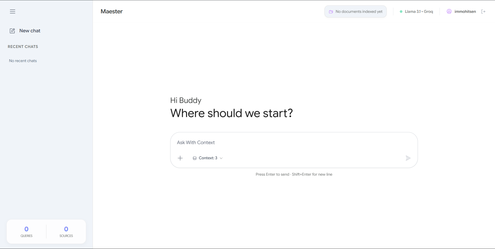
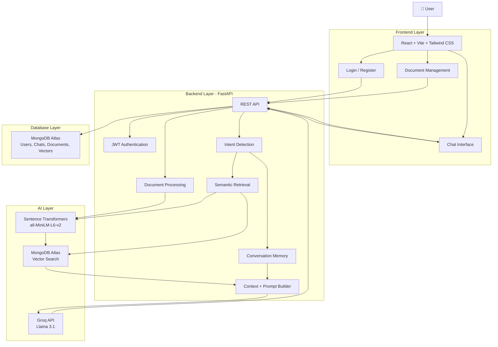
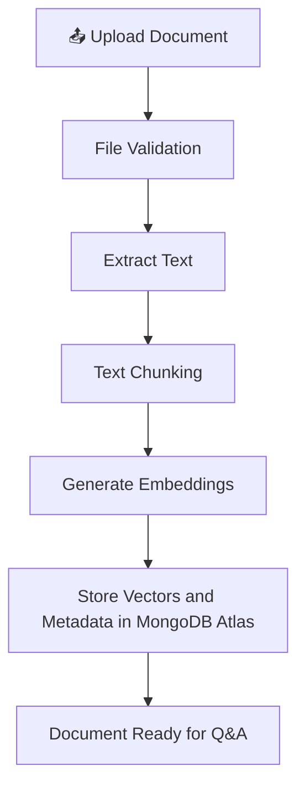
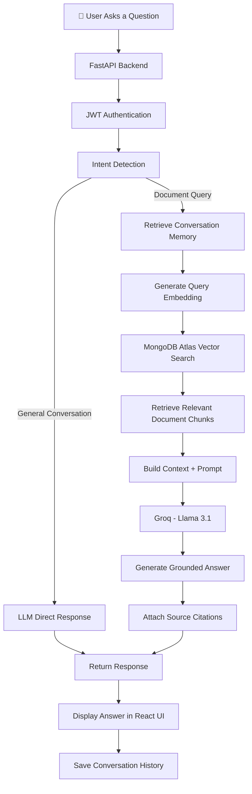

# 🧙 Master — RAG AI Document Assistant

An AI-powered document-based chat application built using **Retrieval-Augmented Generation (RAG)**. Upload your documents, ask questions in natural language, and receive intelligent, context-aware answers grounded in your uploaded files.

Maester combines semantic search, vector embeddings, and Large Language Models (LLMs) to make document interaction easier, faster, and more intelligent.



---

## ✨ Features

- **📄 Document Q&A** — Upload and interact with PDF, DOCX, Excel, TXT, CSV, and JSON files.
- **🔐 User Authentication** — Secure registration and login using JWT authentication and bcrypt password hashing.
- **💬 Persistent Chat History** — Save, access, and resume previous conversations across sessions.
- **🧠 Conversation Memory** — Summary-based memory allows the LLM to retain context from previous interactions.
- **📁 Selective File Context** — Choose specific uploaded documents to use as context for individual queries.
- **🔎 Semantic Search** — Retrieve relevant document chunks using MongoDB Atlas Vector Search.
- **📚 Source Citations** — Display the document chunks used to generate answers, along with confidence scores.
- **🎯 Intent Detection** — Distinguish between general conversations and document-related queries to route requests appropriately.

---

## 🏗️ System Architecture

Maester follows a modular client-server architecture where the React frontend communicates with a FastAPI backend. The backend coordinates authentication, document processing, semantic retrieval, LLM responses, and database storage.



---

## 🔄 RAG Workflow

The core of Maester is its Retrieval-Augmented Generation pipeline.

Instead of asking an LLM to answer questions using only its pretrained knowledge, Maester retrieves relevant information from uploaded documents and supplies it as context.

### 1. Document Ingestion Pipeline



### 2. Question Answering Pipeline



### 3. How RAG Works in Maester

| Step | Process | Description |
|---|---|---|
| 1 | Document Upload | User uploads a supported file. |
| 2 | Text Extraction | Extract text from the uploaded document. |
| 3 | Chunking | Divide extracted text into smaller chunks. |
| 4 | Embedding | Convert chunks into numerical vector representations. |
| 5 | Vector Storage | Store embeddings and metadata in MongoDB Atlas. |
| 6 | Query Embedding | Convert the user's question into an embedding. |
| 7 | Retrieval | Find semantically relevant chunks using vector search. |
| 8 | Generation | Pass retrieved context to Llama 3.1 through Groq. |
| 9 | Response | Generate an answer with document source citations. |

---

## 🛠️ Tech Stack

| Layer | Technology |
|---|---|
| Frontend | React.js, Vite, Tailwind CSS |
| Backend | Python, FastAPI |
| Database & Vector Search | MongoDB Atlas |
| Embedding Model | all-MiniLM-L6-v2 |
| LLM | Llama 3.1 via Groq API |
| Authentication | JWT, bcrypt |

---

## 📂 Project Structure

```text
Maester/
│
├── backend/
│   ├── main.py
│   ├── requirements.txt
│   └── ...
│
├── frontend/
│   ├── public/
│   │   └── home.png
│   ├── src/
│   ├── package.json
│   └── ...
│
├── .gitignore
└── README.md
```

---

## 🚀 Getting Started

Follow these steps to run Maester locally.

### Prerequisites

- Python 3.10+
- Node.js and npm
- MongoDB Atlas account
- Groq API key

### 1. Clone the Repository

```bash
git clone https://github.com/sandeep8764/RAG-AI-Assistant.git

cd RAG-AI-Assistant
```

### 2. Backend Setup

```bash
cd backend

pip install -r requirements.txt

python main.py
```

The FastAPI backend runs at:

```text
http://127.0.0.1:8000
```

### 3. Frontend Setup

Open another terminal:

```bash
cd frontend

npm install

npm run dev
```

Configure the frontend API URL in `frontend/.env`:

```env
VITE_API_URL=http://127.0.0.1:8000/api
```

---

## 🔑 Environment Variables

Create a `.env` file in the backend directory and configure the following variables:

```env
GROQ_API_KEY=your_groq_api_key

MONGODB_URI=your_mongodb_connection_string

JWT_SECRET=your_jwt_secret
```

**
